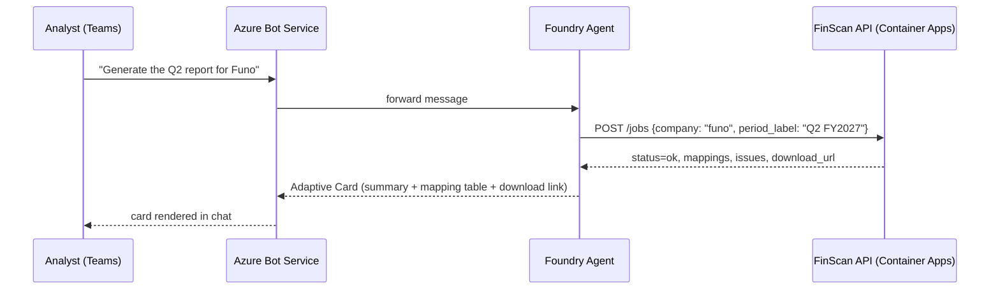

# Deploying FinScan on Azure with an AI Foundry agent in Teams

Goal: an analyst types **"generate the Q2 report for Funo"** in a Teams channel
and gets back an updated workbook + summary, with FinScan doing the PDF
extraction and Excel writing exactly as it does today from the CLI.

FinScan itself doesn't change shape. It stays a stateless HTTPS API
(`src/finscan/api/main.py`) that takes a PDF + workbook and returns a job. What's
new is *what calls that API*: instead of (or alongside) Copilot Studio, an
**Azure AI Foundry Agent** with an OpenAPI tool, published to Teams as a bot.

## Architecture

```mermaid
flowchart LR
    subgraph Teams
        U[Analyst in Teams chat]
    end

    subgraph "Azure Bot Service"
        BOT[Bot channel registration]
    end

    subgraph "Azure AI Foundry Project"
        AGENT[Foundry Agent\nsystem prompt + OpenAPI tool]
        MODEL[gpt-4o deployment]
    end

    subgraph "Azure Container Apps"
        API[FinScan FastAPI\n(existing Dockerfile)]
    end

    subgraph "Storage"
        FILES[Azure Files\nprofiles/ + work dir]
        BLOB[Blob Storage\ninbound PDFs / models]
    end

    KV[Key Vault\nAPI keys, OpenAI key]
    AI[Application Insights]

    U <--> BOT
    BOT <--> AGENT
    AGENT -- "reasons about the request" --> MODEL
    AGENT -- "OpenAPI tool call\n(ProposeUpdate / ConfirmProfile / ApplyUpdate)" --> API
    API --> FILES
    API <--> BLOB
    API -- "AZURE_OPENAI_*" --> MODEL
    API --> KV
    API --> AI
```

Sequence for the one line the user actually types:



If `status=awaiting_confirmation` (new company / layout changed), the agent
shows the sheet-toggle card instead and calls `ConfirmProfile` then
`ApplyUpdate` on submit — this is the exact same branch already designed for
Copilot Studio in [copilot_studio_setup.md](copilot_studio_setup.md); Foundry
Agent Service and Copilot Studio consume the same underlying OpenAPI tool
shape, so nothing in FinScan itself needs to know which one is calling it.

---

## Phase 0 — Prerequisites

1. Azure subscription with quota for Azure OpenAI (`gpt-4o`) in a supported
   region (e.g. `eastus2`, `swedencentral`).
2. `az` CLI ≥ 2.60 logged in: `az login`, `az account set --subscription <id>`.
3. A resource group: `az group create -n rg-finscan-prod -l eastus2`.
4. Decide the auth model for the API up front: start with the existing
   `x-api-key` header (already implemented in `main.py`'s `auth()`), move to
   Azure AD app-to-app auth later (Phase 8) if this becomes multi-tenant.
5. Microsoft 365 tenant with permission to register a Bot/Teams app
   (needed in Phase 6, not before).

## Phase 1 — Host the FinScan API on Azure Container Apps

The repo already has a working `Dockerfile`; this phase just gives it a home.

1. Create the registry: `az acr create -n finscanacr -g rg-finscan-prod --sku Basic`.
2. Build and push the image with ACR Tasks (no local Docker needed):
   ```bash
   az acr build --registry finscanacr --image finscan:latest .
   ```
3. Create a storage account + Azure Files share for **persistent** profile
   storage — this is the single most important piece of state in the whole
   system (`FINSCAN_PROFILE_STORE`); losing it means re-confirming every
   company's layout.
   ```bash
   az storage account create -n finscansa -g rg-finscan-prod --sku Standard_LRS
   az storage share-rm create --storage-account finscansa -n finscan-data --quota 100
   ```
4. Create a Key Vault and put secrets in it (`finscan-api-key`,
   `azure-openai-api-key`) — never as plain Container App env vars.
5. Deploy everything else (Log Analytics, App Insights, Container Apps
   environment, the Container App with the Azure Files mount and Key
   Vault–backed secrets) via [infra/main.bicep](../infra/main.bicep):
   ```bash
   az deployment group create \
     -g rg-finscan-prod \
     -f infra/main.bicep \
     -p infra/main.parameters.json \
     -p containerImage=finscanacr.azurecr.io/finscan:latest \
        finscanApiKey='<generate one>' \
        azureOpenAiApiKey='<from your Foundry project>' \
        azureOpenAiEndpoint='https://<your-foundry-resource>.openai.azure.com/'
   ```
6. Verify: `curl https://<fqdn>/health` → `{"status":"ok","llm_configured":true}`.
7. Smoke-test the real flow once over HTTPS before touching Foundry:
   ```bash
   curl -X POST https://<fqdn>/inspect -H "x-api-key: $KEY" \
        -F workbook=@inbox/Funo/Funo\ Mexico_1Q26_30\ Apr\ 2026\ Real\ Estate\ Public.xlsm
   ```

## Phase 2 — Stand up the Azure AI Foundry project + model

1. Create the Foundry project (portal is easiest the first time:
   [ai.azure.com](https://ai.azure.com) → **+ New project**), or via CLI:
   ```bash
   az extension add -n ml
   az ml workspace create --kind project -n finscan-foundry -g rg-finscan-prod
   ```
2. In the project, deploy a `gpt-4o` model under **Deployments**. This gives
   you the `AZURE_OPENAI_ENDPOINT` / deployment name FinScan itself already
   expects in `config.py` — point the Container App's env vars at *this*
   endpoint (same Azure OpenAI resource can serve both FinScan's own
   extraction calls and the Foundry Agent's reasoning).
3. Confirm the deployment works from the Foundry portal's playground before
   wiring an agent to it.

## Phase 3 — Build the Foundry Agent ("the front door")

1. In the Foundry project → **Agents** → **New agent**. Pick the `gpt-4o`
   deployment from Phase 2.
2. System instructions — port the topic design already written for Copilot
   Studio almost verbatim (see [copilot_studio_setup.md](copilot_studio_setup.md)
   §4): call `ProposeUpdate` first, branch on `status`
   (`awaiting_confirmation` / `needs_review` / `ok`), never let the model
   restate extracted numbers itself — always echo the API's own `summary`,
   `mappings`, `issues` fields verbatim (same "keep the numbers out of
   generative answers" rule as the Copilot Studio doc — it applies here
   identically, the model is just as capable of quietly rounding a number).
3. **Add an OpenAPI tool** → upload
   [docs/foundry_agent_tool.openapi.yaml](foundry_agent_tool.openapi.yaml)
   (OpenAPI **3.0**, unlike the Swagger 2.0 file needed for Power Platform —
   Foundry's OpenAPI tool accepts 3.0 directly, no conversion needed).
   - Edit the `servers.url` to your Container App's FQDN from Phase 1.
   - Auth: **API key**, header `x-api-key`, value = the same secret stored
     in Key Vault.
4. Test in the Foundry playground: "generate the Q2 report for Funo" and
   confirm it calls the tool and renders `summary`/`mappings`.

## Phase 4 — Give the agent a "generate this company's report" action

Today's API is upload-first (`POST /jobs` takes `pdf` + `workbook` files
directly), which fits Copilot Studio's file-picker UI. A Teams chat message
has no file picker for "the Funo model" — the agent needs to resolve
*"Funo"* to actual files itself. Two small, additive options, pick one:

- **A — reuse the demo pattern for production.** `finscan.demo.folder` already
  resolves `"Tancent" + "q325"` → files on disk
  (`api/main.py`'s `/demo/update`). Generalize this one function to read from
  a Blob container (`inbox/<company>/*.pdf`, `models/<company>.xlsx`) instead
  of a local folder — same interface, same `run_graph()` call, just a
  different `resolve_files()` backend. This is the smallest change: one new
  module (`finscan/demo/blob_source.py` alongside the existing
  `finscan/demo/folder.py`) and one new endpoint, `/reports/generate`,
  mirroring `/demo/update`.
- **B — SharePoint-first.** Keep the existing per-file upload endpoints
  exactly as they are, and have the *agent's tool* be "trigger the existing
  SharePoint Flow" (Phase 5 of the Copilot Studio doc) rather than a new
  FinScan endpoint — Teams chat just asks Power Automate to re-run.

(A) is more natural for "ask in chat, get a report" since it needs no prior
SharePoint wiring; (B) is less new code if the SharePoint flow from
`copilot_studio_setup.md` already exists. Tell me which and I'll write the
new module/endpoint.

## Phase 5 — Publish the agent to Microsoft Teams

1. Foundry project → your agent → **Channels** → **Microsoft Teams** (Foundry
   Agent Service provisions the Azure Bot Service registration for you when
   you use this button — no manual Bot Framework SDK code needed).
2. This creates an Azure AD app registration for the bot automatically;
   note the app ID.
3. **Package and publish to Teams**:
   - Foundry generates a Teams app manifest — download it.
   - Teams admin center → **Manage apps** → upload for org-wide availability,
     or sideload it into your own tenant for a pilot with a handful of
     analysts first.
4. Test end-to-end from an actual Teams client, not just the Foundry
   playground — Adaptive Card rendering can differ slightly.

## Phase 6 — Security pass before wider rollout

1. Move `FINSCAN_API_KEY` auth to Azure AD (Entra ID) app-to-app auth: give
   the Foundry Agent's managed identity/service principal a role, validate
   the bearer token in FastAPI instead of a static header — closes off the
   "static key leaks" risk the current `x-api-key` scheme carries.
2. Container App identity already only has `Key Vault Secrets User` +
   `AcrPull` (see the bicep) — keep it that way, resist adding broader roles.
3. Turn on Container Apps' built-in **IP restrictions** or put it behind
   **Azure Front Door / API Management** if you want WAF rules in front of
   file uploads (PDFs/xlsm from an LLM-driven chat surface are exactly the
   kind of upload path worth a virus-scan step — consider Defender for
   Storage on the Blob container from Phase 4).
4. Rotate `finscan-api-key`/`azure-openai-api-key` via Key Vault, not by
   hand — Container Apps re-reads Key Vault secret refs on revision restart.

## Phase 7 — CI/CD

[.github/workflows/deploy-azure.yml](../.github/workflows/deploy-azure.yml)
builds the image via `az acr build` and updates the Container App on every
push to `main`, using OIDC federated login (no stored Azure secret). One-time
setup:
```bash
az ad app create --display-name finscan-gh-deploy
# then az ad app federated-credential create ... for the repo:ref:refs/heads/main subject
```
Wire the resulting client/tenant/subscription IDs into the repo's GitHub
Actions secrets (`AZURE_CLIENT_ID`, `AZURE_TENANT_ID`,
`AZURE_SUBSCRIPTION_ID`, `ACR_NAME`, `AZURE_RESOURCE_GROUP`).

## Phase 8 — Observability & rollout

1. Application Insights is already wired into the bicep — check the
   Container App's `traces`/`requests` show up after the first `/health` hit.
2. Add an alert on Container App restarts and on 5xx rate — a silent crash
   here means every Teams request for every company fails at once.
3. Roll out company-by-company using the existing onboarding sequence from
   `RUNNING.md`/`copilot_studio_setup.md` §7: `POST /inspect` first over the
   whole model library, fix the handful without a blue/black convention,
   *then* let Teams traffic in.
4. Pilot with a few analysts in one Teams channel before org-wide Teams app
   approval — the confirmation-gate design means the first message per
   company is a real review step, not a rubber stamp; make sure reviewers
   know that's expected.

---

### What's genuinely new vs. what's reused

| Piece | Status |
|---|---|
| FastAPI service, Dockerfile, extraction/writing pipeline | **unchanged** |
| Azure OpenAI config (`config.py`) | **unchanged**, just pointed at the Foundry project's deployment |
| Confirmation-gate UX (`awaiting_confirmation`/`needs_review`/`ok`) | **unchanged**, same branch logic, new caller |
| Copilot Studio topic design | reused almost verbatim as the Foundry Agent's system prompt |
| Container Apps hosting, Key Vault, CI/CD | **new** (this doc + `infra/`) |
| "Resolve company name → files" for a chat-only request | **new, small** (Phase 4) |
| Teams channel registration | **new**, but a one-click Foundry feature, not custom bot code |
