# FinScan2 Architecture and Deployment Guide

FinScan2 reads a company's filing, resolves reviewed mapping rules, and writes
the reporting period into a copy of that company's Excel model. The filing,
mapping decision, value, source caption, source page, and written output remain
available for review.

This guide separates **Current** behavior (implemented in `src/finscan2`) from
the **Target** Azure deployment. FinScan2 is currently a local CLI; it has no
HTTP API, MCP server, Teams bot, Foundry agent, or Blob Storage integration.

## Contents

1. [How to read this guide](#1-how-to-read-this-guide)
2. [Executive summary](#2-executive-summary)
3. [Current system context](#3-current-system-context)
4. [Target cloud context](#4-target-cloud-context)
5. [Trust boundaries and identity](#5-trust-boundaries-and-identity)
6. [Repository structure](#6-repository-structure)
7. [Company-owned configuration](#7-company-owned-configuration)
8. [Current local execution](#8-current-local-execution)
9. [Run lifecycle](#9-run-lifecycle)
10. [Filing reader](#10-filing-reader)
11. [Model learning](#11-model-learning)
12. [Resolve, validate, and write](#12-resolve-validate-and-write)
13. [Optional model and vision reader](#13-optional-model-and-vision-reader)
14. [Safety controls](#14-safety-controls)
15. [Audit artifacts](#15-audit-artifacts)
16. [Target service topology](#16-target-service-topology)
17. [API and job contract](#17-api-and-job-contract)
18. [Storage design](#18-storage-design)
19. [Foundry and Teams](#19-foundry-and-teams)
20. [Model access without Foundry](#20-model-access-without-foundry)
21. [Identity and secrets](#21-identity-and-secrets)
22. [Observability](#22-observability)
23. [Scaling and reliability](#23-scaling-and-reliability)
24. [Deployment strategy](#24-deployment-strategy)
25. [CI/CD and promotion](#25-cicd-and-promotion)
26. [Security and cost controls](#26-security-and-cost-controls)
27. [Migration from retired FinScan](#27-migration-from-retired-finscan)
28. [Open implementation work](#28-open-implementation-work)

## 1. How to read this guide

| Label | Meaning |
|---|---|
| **Current** | Implemented in FinScan2 today. |
| **Target** | Recommended Azure design; not implemented yet. |
| **Optional** | Used only when a company or deployment needs it. |

The retired `src/finscan` FastAPI/LangGraph service is out of scope. Do not reuse
its API, Docker command, or Foundry OpenAPI definition as the FinScan2 contract.

## 2. Executive summary

Deploy FinScan2 as one versioned worker image plus a small job API. The worker is
the only component that parses PDFs, resolves mappings, validates values, and
writes workbooks. The API accepts requests and reports status; it does not run a
long Excel job inside an HTTP request.

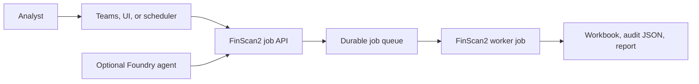

Azure AI Foundry is optional. It is a conversational client for Teams, not the
financial processing engine.

## 3. Current system context

**Current.** An operator places files locally and runs the CLI. The reviewed
mapping is the human contract; the source workbook is never modified.

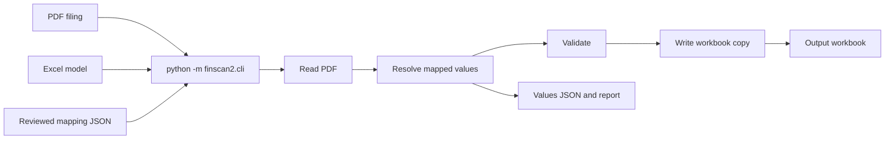

```powershell
.\.venv\Scripts\python.exe -m finscan2.cli company ccu run
```

## 4. Target cloud context

**Target.** Azure replaces local folders with durable storage and replaces an
interactive process with an asynchronous worker job. The financial pipeline does
not change.

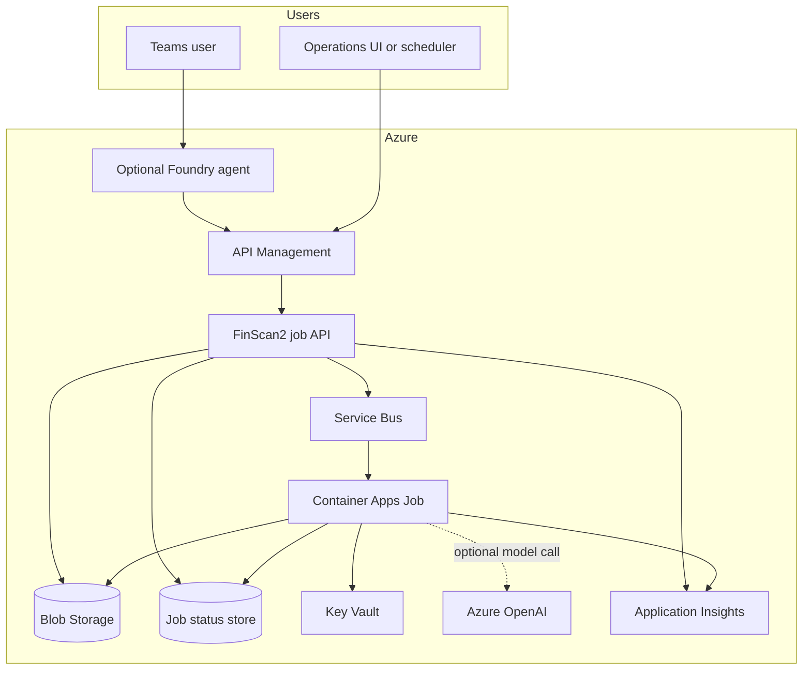

## 5. Trust boundaries and identity

The API is the external boundary. Teams, Foundry, an internal UI, or a scheduler
uses an Entra ID token to call it. The worker receives jobs only from the queue.

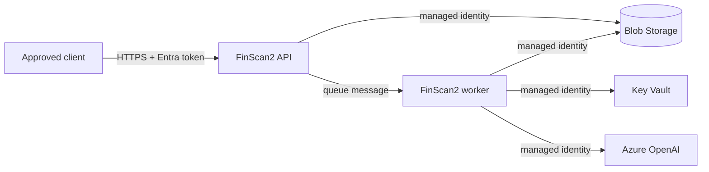

The Foundry agent must have API access only, never direct Blob or Key Vault access.

## 6. Repository structure

| Location | Purpose |
|---|---|
| `src/finscan2/pdf/` | PDF text/table parsing, OCR, and optional vision reader. |
| `src/finscan2/model/` | Excel layout discovery and derived model specification. |
| `src/finscan2/mapping/` | Mapping schema and reviewed decision proposal support. |
| `src/finscan2/match/` | Caption lookup, sums, periods, and value resolution. |
| `src/finscan2/write/` | Workbook copy, input writes, formulas, and comments. |
| `mappings/` | Git-tracked company decisions. |
| `models/` | Derived layouts, safe to regenerate. |
| `inbox/` | Local development inputs. |
| `_work/` | Local cache and audit output. |

## 7. Company-owned configuration

Each mapping records the sheet, PDF captions, sums, constants, explicit
carry-forward decisions, and optional extra note-table titles. This makes
company-specific knowledge visible and reviewable instead of hidden in code.

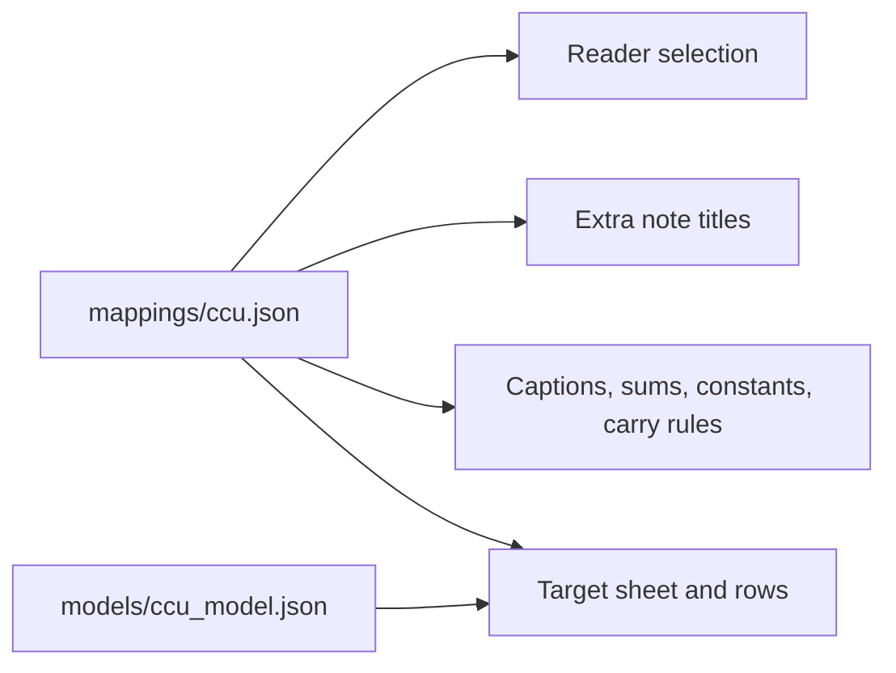

Mappings should be approved through source control or a controlled mapping-bundle
promotion process. A chat agent must not edit them freely.

## 8. Current local execution

`company <key> run` reads every company PDF, learns a mapping only when none
exists, then applies the reviewed mapping. Individual diagnostic stages remain:

```powershell
python -m finscan2.cli company ccu read
python -m finscan2.cli company ccu learn
python -m finscan2.cli company ccu apply
```

## 9. Run lifecycle

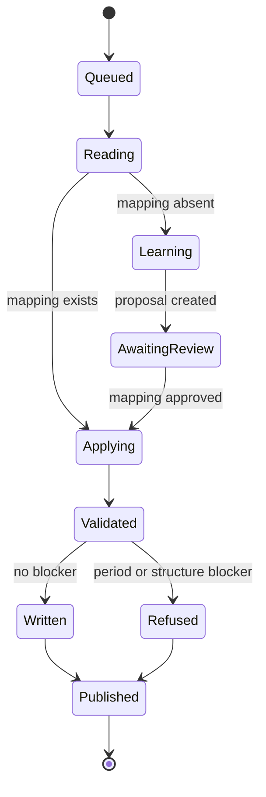

In Azure, these become durable job states rather than console messages.

## 10. Filing reader

The rule-based reader produces `PdfDoc`: pages, statements, columns, captions,
printed figures, units, source pages, and issues. Reads are cached by PDF hash,
parser version, and relevant reader configuration.

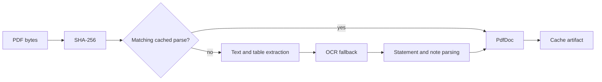

Mappings can declare `extra_statements` to read a specific note table, such as a
CCU D&A or ORBDA disclosure, without introducing a generic hardcoded exception.

## 11. Model learning

Learning discovers Excel structure: target sheet, period columns, input/formula
rows, units, labels, and next write column. It writes a derived model JSON and
can propose a mapping. Existing reviewed mappings are not overwritten.

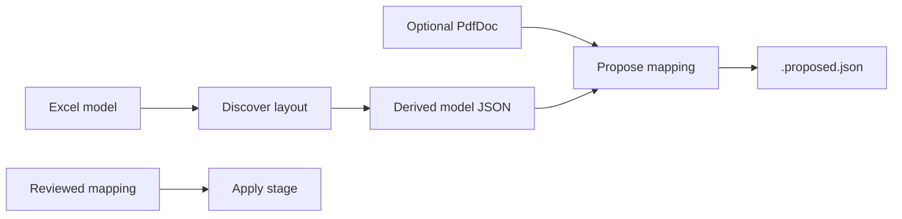

## 12. Resolve, validate, and write

Apply resolves and writes together so an edited mapping cannot be used with stale
intermediate values.

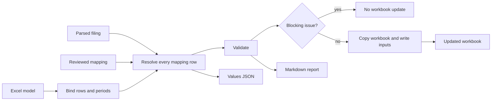

Formula cells are copied or rebuilt under declared rules. Missing captions remain
visible as unresolved; they are not guessed.

## 13. Optional model and vision reader

Rule-based parsing is the default. A mapping may explicitly set `"reader": "llm"`
for filings where table layout cannot be read reliably from text.

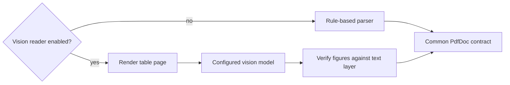

Vision reads are cached. Unverified figures must not be written automatically.

## 14. Safety controls

| Control | Purpose |
|---|---|
| Hash/version cache | Reuses reviewed parses and makes parser changes explicit. |
| Reviewed mappings | Controls company-specific decisions. |
| Period binding | Stops writes to an incorrect reporting column. |
| Column selection | Selects the requested period instead of assuming the first number. |
| Dash handling | A found dash can be zero; a missing caption remains an error. |
| Formula protection | Prevents overwriting calculated model cells. |
| Source page/caption | Enables row-level review. |
| Output copy | Preserves the original workbook. |

## 15. Audit artifacts

Publish one immutable artifact set per completed job:

```text
jobs/<job-id>/
  input-manifest.json
  source-filing.pdf
  parsed-filing.pdf.json
  mapping.json
  model.json
  values.json
  report.md
  workbook.xlsx or workbook.xlsm
```

The manifest records company, period end, filing hash, mapping version, parser
version, optional model/prompt version, timestamps, and final state.

## 16. Target service topology

Use two workloads built from the same FinScan2 image:

| Workload | Azure host | Responsibility |
|---|---|---|
| Job API | Container App | Authenticate, locate approved input, create/report jobs. |
| Worker | Container Apps Job | Execute FinScan2 and publish immutable artifacts. |

Do not split parsing, matching, validation, and writing into microservices. They
share one audit context and should execute as one worker transaction.

## 17. API and job contract

**Target minimal contract:**

```text
POST /jobs
  company, filing reference, workbook reference, optional period end
  -> job_id, status=queued

GET /jobs/{job_id}
  -> state, warnings, audit summary, artifact links

GET /jobs/{job_id}/download
  -> short-lived workbook download

POST /jobs/{job_id}/approve-mapping
  -> releases an awaiting-review job after human approval
```

The API must reject an ambiguous "latest" request, for example when two approved
CCU filings have the same period end.

## 18. Storage design

**Target.** Blob Storage is the durable cloud file store and replaces local
`inbox/` and `_work/` directories.

```text
finscan-inputs/
  inbound/<company>/<period-end>/<filing-id>.pdf
  models/<company>/<model-version>.xlsx

finscan-artifacts/
  jobs/<job-id>/input-manifest.json
  jobs/<job-id>/values.json
  jobs/<job-id>/report.md
  jobs/<job-id>/output.xlsx
```

"Latest" means the newest **approved financial period**, not the most recently
uploaded file. Store `company`, `period_end`, `filing_type`, `approved`, and
source ID in the manifest or a job/input database record.

## 19. Foundry and Teams

Foundry is optional and only provides a conversational interface. It calls the
FinScan2 API, polls job state, and presents the audited response.

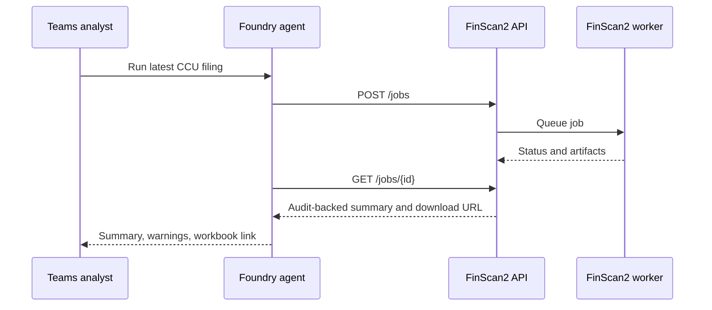

The agent must repeat numbers and warnings from the API audit, never calculate or
reinterpret financial values itself.

## 20. Model access without Foundry

FinScan2 can call Azure OpenAI directly; Foundry is not required for model access.

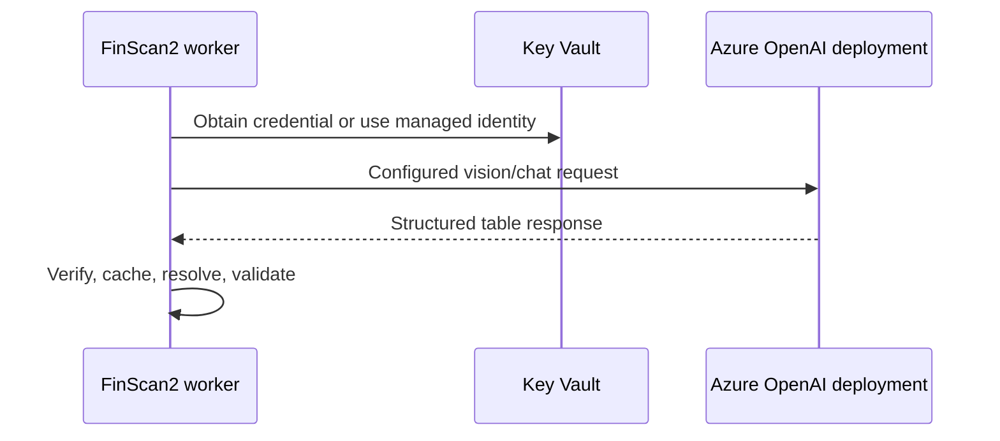

Before retiring legacy FinScan, isolate current shared LLM configuration behind a
FinScan2-specific provider configuration and managed-identity client.

## 21. Identity and secrets

Use user-assigned managed identities and least-privilege RBAC:

| Identity | Access |
|---|---|
| API | Queue messages, job records, artifact download links. |
| Worker | Read inputs, write artifacts, read Key Vault, invoke Azure OpenAI. |
| CI | Push ACR images and update Azure resources. |
| Foundry | Call the FinScan2 API only. |

Do not store storage keys, API keys, or SAS tokens in source control.

## 22. Observability

Every request and run has one `job_id` correlation ID. Capture company, period,
filing hash, mapping/parser/model versions, stage durations, model-call count,
resolved/blank/warning/error counts, output URI, and final state.

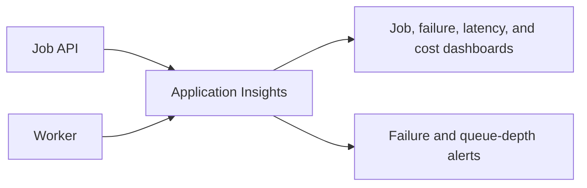

Avoid logging full filing text or workbook cells into shared telemetry.

## 23. Scaling and reliability

| Concern | Recommendation |
|---|---|
| Long-running work | Asynchronous Container Apps Job per filing. |
| Concurrency | Start with low per-company/model concurrency; increase after quota and memory testing. |
| Duplicate submission | Idempotency key: company + filing hash + mapping version + operation. |
| Retry | Retry transient infrastructure/model failures, not business validation failures. |
| Output publication | Publish only after values JSON, report, and workbook all exist. |
| Desktop Excel locks | Eliminated in cloud: each job writes a new Blob output. |

## 24. Deployment strategy

### Phase A: cloud batch proof

1. Build a FinScan2 worker image.
2. Run a Container Apps Job on one known PDF/workbook/mapping set.
3. Write the workbook and full audit artifact set to Blob Storage.
4. Compare cloud outputs with local CCU and Almarai audits.

### Phase B: asynchronous service

1. Add the Job API, Service Bus, and durable job state.
2. Enforce Entra ID and managed-identity Storage access.
3. Add dashboards, alerts, idempotency, and retention.

### Phase C: analyst experience

1. Add an operations UI or Power Automate trigger.
2. Add Foundry/Teams only if natural-language job submission is valuable.
3. Pilot selected companies before broad rollout.

## 25. CI/CD and promotion

Use GitHub Actions with OIDC, not stored Azure credentials.

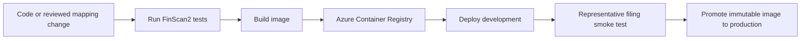

Promote approved mapping commits with known image versions and record both in each
job manifest.

## 26. Security and cost controls

Security:

- Require Entra ID at the API boundary.
- Use API Management or Front Door, and scan external uploads before enqueueing.
- Use private/limited Blob access and time-limited download URLs.
- Retain immutable artifacts according to financial-control policy.

Cost:

- Rule-based parsing has no model cost.
- Enable vision only in mappings that require it.
- Cache by filing hash and parser/prompt version.
- Record model pages and model deployment per job.
- Scale worker jobs to zero between filings.

## 27. Migration from retired FinScan

The existing `src/finscan` deployment assets are not a FinScan2 deployment.
Before retirement:

1. Create FinScan2-specific Docker entry points.
2. Add the FinScan2 API and worker job launcher.
3. Create a FinScan2 OpenAPI contract only if Foundry/Teams is needed.
4. Replace legacy-specific environment and LLM configuration.
5. Validate cloud results against FinScan2 audit artifacts.
6. Move consumers to FinScan2, then remove legacy runtime deployments.

## 28. Open implementation work

These are target-deployment tasks, not current features:

- FinScan2 FastAPI Job API;
- Service Bus and Container Apps Job launcher;
- Blob input resolver and immutable artifact publisher;
- durable job-status/idempotency store;
- FinScan2-specific Azure OpenAI managed-identity client;
- Entra ID authorization and Key Vault integration;
- FinScan2 Bicep and GitHub Actions workflow;
- Foundry/Teams OpenAPI contract, only if required;
- production runbook, retention policy, alerts, and disaster recovery.

Until then, the supported execution model is the local FinScan2 CLI.